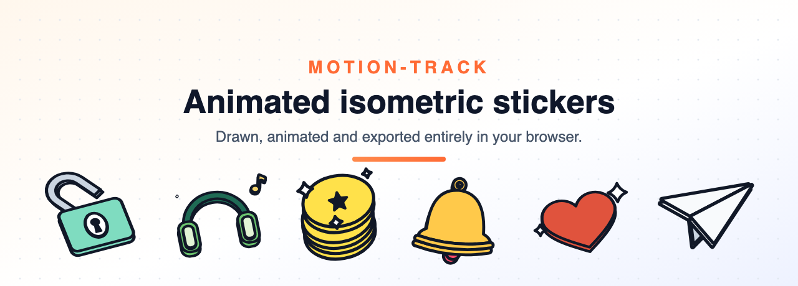
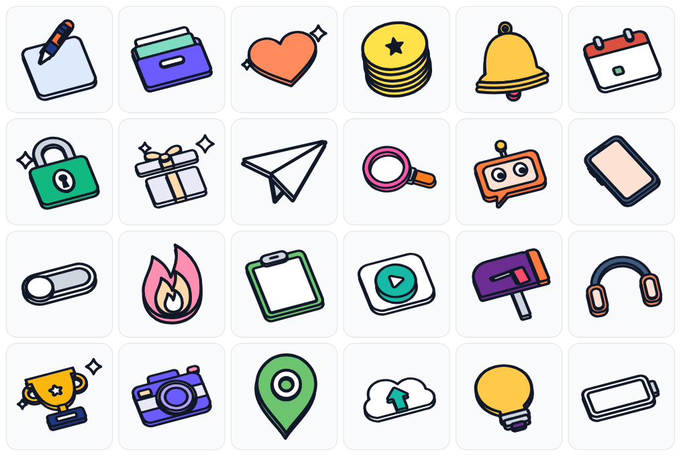
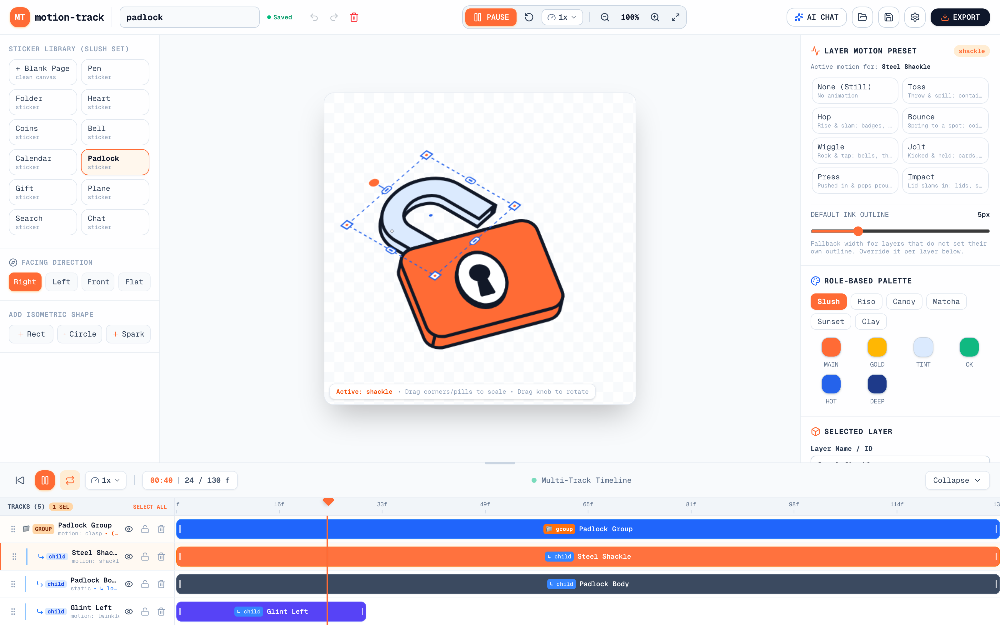
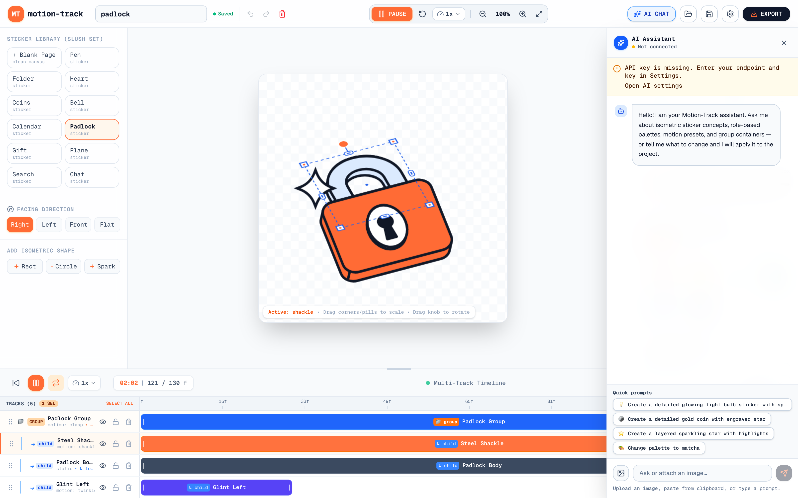
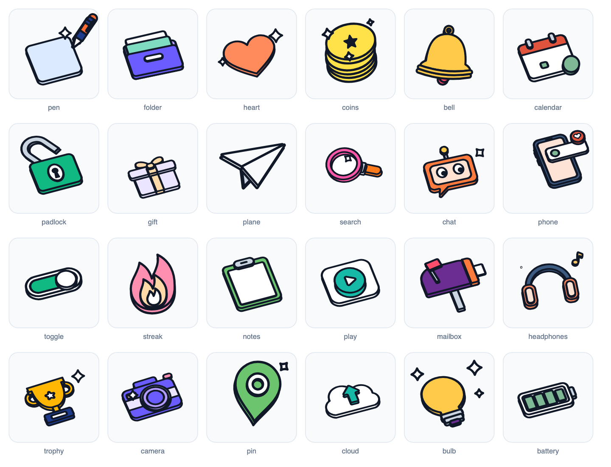

<div align="center">
  
  <h1>Motion-Track</h1>
</div>

<div align="center">
  
</div>

<div align="center">

[](LICENSE)


</div>

**Motion-Track** is a browser-based studio for building animated isometric slab
stickers — the bold-outline, extruded-3D look you see above. Draw a layered
sticker, give each layer a motion, scrub the timeline, and export a GIF, MP4 or
ProRes 4444 MOV with alpha. No account, no server, no upload: everything is
computed locally in the tab.

<div align="center">
  
  <br>
  <sub>Twenty-four stickers ship with the app, already animated.</sub>
</div>

## Screenshots

### The studio

<div align="center">
  
</div>

### The AI assistant

<div align="center">
  
</div>

Describe a sticker in the chat and the assistant replies with validated actions
that are applied to the project as a single undo step — or attach an image and
ask for it to be rebuilt in the house style.

## The sticker library

<div align="center">
  
</div>

24 hand-designed stickers are vendored from the
[fun-isometric](https://github.com/kelvinkn17/skills) skill — `pen`, `folder`,
`heart`, `coins`, `bell`, `calendar`, `padlock`, `gift`, `plane`, `search`,
`chat`, `phone`, `toggle`, `streak`, `notes`, `play`, `mailbox`, `headphones`,
`trophy`, `camera`, `pin`, `cloud`, `bulb` and `battery`.

- **From the sidebar** — pick one under *Sticker Library (Slush Set)* and it
  replaces the canvas, ids and motion included.
- **From the AI chat** — ask for a subject that is in the library and the model
  emits `insert_template` instead of hand-drawing it, so you always get the
  hand-tuned geometry rather than an approximation.

A designed sticker is exempt from auto-fit and auto-centre, so the author's
placement survives, and every inserted layer is given a stable id so the
timeline's hide / lock / delete / reorder controls keep working.

## Features

- **Isometric editor** with four viewing directions (`right`, `left`, `front`,
  `flat`), precise hit testing, draggable/rotatable/scalable layers, zoom, and
  keyboard nudging.
- **Multi-track timeline** with per-layer in/out points, trimming, reordering,
  hide/lock controls, and a seamless loop.
- **21 motion presets** shared by the inspector and the AI prompt, with unknown
  ids safely treated as still.
- **Group containers** that drive the motion of their child layers.
- **Per-layer ink outline** — width is configurable per layer and falls back to
  the document default.
- **Role-based palettes** (`main`, `gold`, `tint`, `ok`, `hot`, `deep`, `white`,
  `grey`, `paper`, `ink`) with six built-in themes and custom color editing.
- **fun-isometric house style**, applied to the AI assistant so generated
  stickers match [the skill](docs/FUN-ISOMETRIC.md): flat slabs, thick ink
  outline, leaned faces, verb-driven motion.
- **Hybrid AI assistant** with direct browser transport by default and an
  opt-in, hardened server relay.
- **AI auto-apply** — the assistant returns validated actions (layers, colors,
  motion, view, outline, naming) applied as one undo step.
- **Transactional undo/redo** with coalesced slider edits and a 50-entry history.
- **Autosave and versioned project files** (v2) with legacy icon-JSON migration.
- **Client-side export** — GIF, MP4 and ProRes 4444 MOV with alpha.
- **Accessibility basics** — focus-trapped modals, labelled controls, visible
  focus rings, reduced-motion handling, toasts, and an error boundary.

## Quick start

Requirements: Node.js 22+ and npm.

```bash
npm install
npm run dev
```

Open <http://localhost:3000>. The editor lives at `/dashboard`.

The `predev` and `prebuild` scripts copy the ffmpeg.wasm ESM wrapper into
`public/ffmpeg/` so it can run same-origin. That directory is generated and
git-ignored.

### Scripts

| Script | Purpose |
| --- | --- |
| `npm run dev` | Start the development server. |
| `npm run build` | Production build. |
| `npm start` | Serve the production build. |
| `npm run lint` | ESLint (Next.js core-web-vitals + TypeScript rules). |
| `npm run typecheck` | `tsc --noEmit`. |
| `npm test` | Vitest unit tests. |
| `npm run test:watch` | Vitest in watch mode. |

## Configuration

### AI relay

Direct mode is the default: the browser calls the OpenAI-compatible provider and
the API key never leaves the tab. Relay mode sends the key through
`/api/ai-proxy` and is only used after the user grants consent in **AI Settings**.

The relay forwards requests to any AI model API endpoint (HTTP or HTTPS). You can
optionally restrict hosts by setting `AI_PROXY_ALLOWED_HOSTS` to a
comma-separated list (wildcards such as `*.example.com` are supported):

```bash
# .env.local
# Leave unset or empty to allow all AI model API URLs
AI_PROXY_ALLOWED_HOSTS=""
```

By default, all AI model endpoints (including remote providers and local/custom
AI gateways) are allowed. See [docs/AI-RELAY.md](docs/AI-RELAY.md).

### Analytics (GA4)

Google Analytics 4 is wired through
[`@next/third-parties`](https://nextjs.org/docs/app/building-your-application/optimizing/third-party-libraries#google-analytics)
and is **off by default**. Add your measurement ID and the `gtag.js` tag is
injected on every route; leave the variable empty and no third-party script is
ever loaded.

```bash
# .env.local
NEXT_PUBLIC_GA_ID=G-XXXXXXXXXX
```

Because the value is inlined at build time, restart (or rebuild) the dev server
after changing it. The tag is rendered from `src/app/layout.tsx`, so App Router
client-side navigations between `/` and `/dashboard` are reported as page views
automatically.

## Brand assets

| File | Use |
| --- | --- |
| `public/logo.svg` | Primary logo mark (header, docs, press). |
| `src/app/icon.svg` | Favicon, served automatically by Next.js. |
| `src/app/apple-icon.png` | 180×180 Apple touch icon. |

## Project structure

```
src/
  app/                 Next.js routes and the AI relay route handler
  components/editor/   Studio shell, canvas, timeline, sidebars, modals
  components/landing/  Marketing page
  components/ui/       Modal, toast provider, error boundary
  hooks/               Playback clock subscriptions
  lib/ai/              AI settings, prompt builder, transport, relay guard
  lib/editor/          History, playback clock, central studio state
  lib/export/          Frame planning and GIF/MP4/MOV encoders
  lib/funIsometric/    Rendering engine, icons, motions, presets, sticker library
  lib/geometry/        Path bounds and precise hit testing
docs/images/           Artwork used by this README (rendered by the engine)
```

Read [docs/ARCHITECTURE.md](docs/ARCHITECTURE.md) for the data flow and design
decisions, [docs/PROJECT_FORMAT.md](docs/PROJECT_FORMAT.md) for the v2 file
schema, [docs/FUN-ISOMETRIC.md](docs/FUN-ISOMETRIC.md) for the drawing and motion
house style applied to the AI assistant, and [docs/EXPORT.md](docs/EXPORT.md) for
the format matrix and limitations.

## Export notes

| Format | Encoder | Alpha | Fallback |
| --- | --- | --- | --- |
| GIF | `gifshot` | 1-bit palette transparency; white fallback | — |
| MP4 | WebCodecs H.264 + `mp4-muxer` | No | MediaRecorder (may produce WebM) |
| MOV | `ffmpeg.wasm` `prores_ks` | Yes (ProRes 4444) | `qtrle` (QuickTime Animation) |

The first MOV export downloads the ffmpeg core from unpkg (about 31 MB). MP4
export requires WebCodecs for a true MP4; older browsers fall back to
MediaRecorder and may produce WebM.

## Browser support

Target browsers are current Chrome, Edge, Safari, and Firefox. MOV export needs
WebAssembly, Workers, and enough memory for the ffmpeg core. MP4 export is best
in Chromium-based browsers where WebCodecs H.264 is available.

## License

MIT — see [LICENSE](LICENSE). The sticker set, renderer and motion presets are
adapted from the MIT-licensed
[fun-isometric](https://github.com/kelvinkn17/skills) skill by Kelvin Adithya;
its notice is reproduced in [THIRD-PARTY-NOTICES.md](THIRD-PARTY-NOTICES.md).
